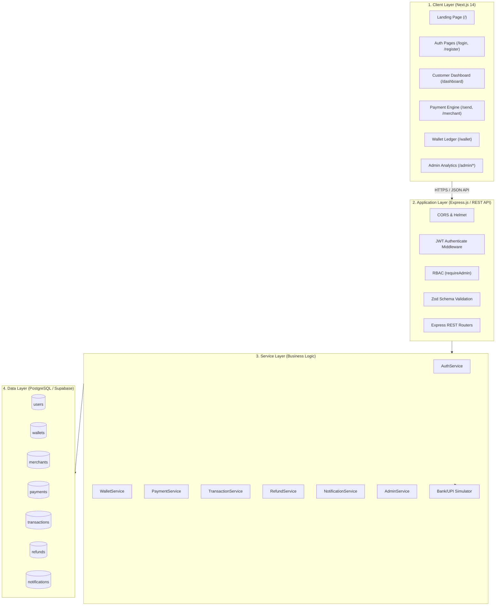
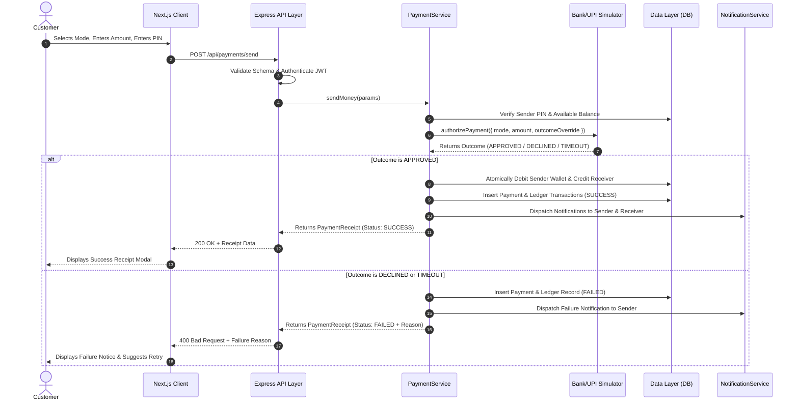

# System Architecture Documentation
## Digital Payment Gateway Simulation

**Document Version:** 1.0.0  
**Authors:** Ankur, Atul, Anamay, Annanya  
**Date:** November 2026  

---

## 1. Architectural Overview

The **Digital Payment Gateway Simulation** is architected as a modern, decoupled **Layered Client-Server Architecture** designed to emulate modern fintech payment infrastructure (such as Razorpay, Stripe, and NPCI Unified Payments Interface) in an educational, sandboxed environment.

---

## 2. Layer Definitions

### A. Client Layer (Next.js & React)
- **Role:** Presents an accessible, responsive fintech user interface.
- **Key Concepts:**
  - Client-side navigation with Next.js App Router.
  - Component-driven architecture using reusable design primitives (Card, Badge, Button, Input, Modal).
  - Dynamic simulation controls allowing interactive testing of `APPROVED`, `DECLINED`, and `TIMEOUT` scenarios.
  - State management via React Context (`AuthContext`) handling session tokens, user profiles, and active wallet balance syncing.

### B. Application Layer (Express REST APIs)
- **Role:** Handles HTTP transport, request sanitization, authentication, and role authorization.
- **Key Middleware:**
  - `authenticate`: Extracts and cryptographically verifies Bearer JWT tokens, validating user account status.
  - `requireAdmin`: Enforces administrative RBAC permissions on protected routes.
  - `validateBody(schema)`: Validates incoming request payloads against strict Zod type definitions before passing to controllers.
  - `errorHandler`: Traps all operational and runtime errors, logging stack traces and formatting standard JSON error responses.

### C. Service Layer
- **Role:** Encapsulates core business rules, transactional logic, and bank simulation interactions.
- **Key Services:**
  - `PaymentService`: Orchestrates payment validation, PIN comparison, balance verification, simulator invocation, atomic ledger recording, and multi-party notifications.
  - `BankSimulator`: Decoupled mock switch simulating NPCI UPI and Card authorization switches with realistic latency and deterministic outcome rules.
  - `WalletService`: Manages authoritative ledger balances, safe balance mutations (`balance >= 0`), and top-ups.
  - `RefundService`: Validates refund eligibility, verifies remaining balance, and atomically returns funds.

### D. Data Layer (Database & Storage)
- **Role:** Enforces data integrity, relationships, and persistence.
- **Schema Design:**
  - Foreign key constraints ensure relational integrity (`users -> wallets`, `payments -> transactions`).
  - Check constraints ensure `balance >= 0.00` and `amount > 0.00`.
  - Indexes on `email`, `mobile`, `reference_id`, and `status` optimize query performance.
  - Compatible with Supabase PostgreSQL and includes an in-memory transactional fallback for zero-dependency local runs.

---

## 3. Core Workflow Sequence

### 3.1 End-to-End Payment Sequence

---

## 4. Security & Safety Model

1. **Simulated Sandbox Boundary:** No real card credentials or bank network tokens are accepted. All account data is virtual.
2. **Credential Protection:** Passwords and PINs are hashed using bcrypt with salt rounds = 10. PINs are never included in API responses or serialized objects.
3. **JWT Stateless Tokens:** Digitally signed JWT tokens carry standard expiry (24 hours).
4. **No Client Trust:** authoritative calculations (balances, eligibility, permissions) are strictly performed server-side.
